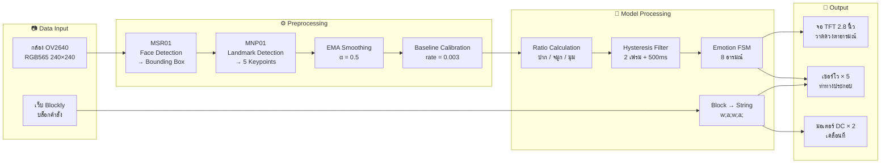
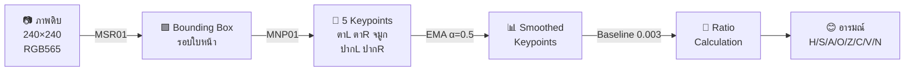
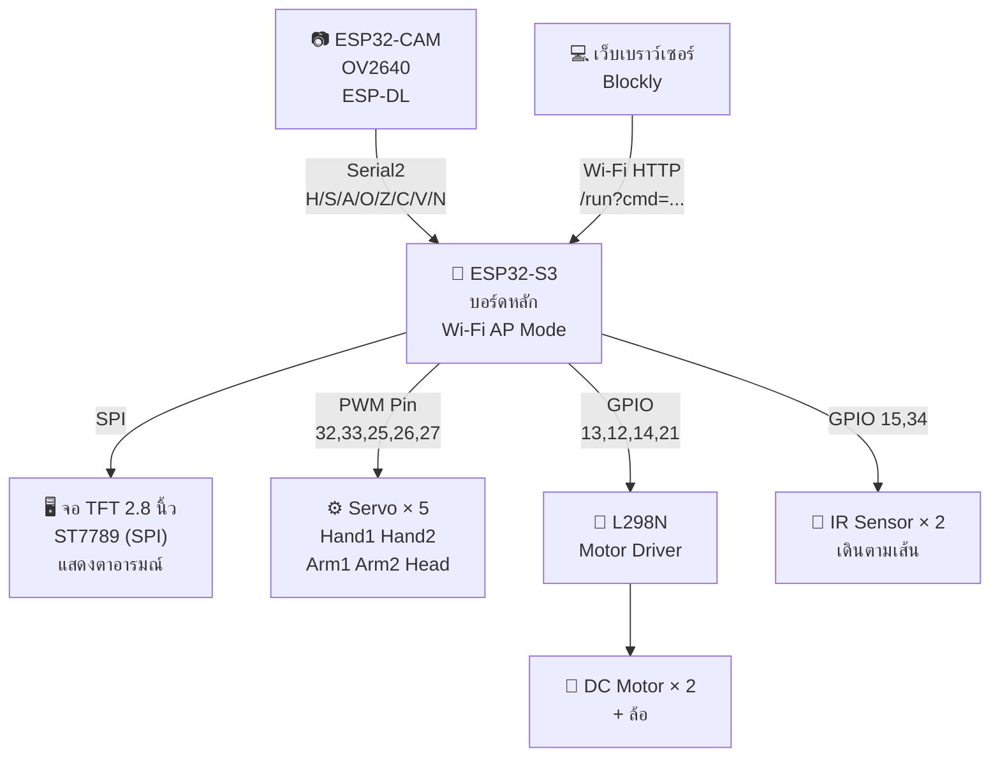

# แผนภาพประกอบบทที่ 3 — เปิด Preview แล้วแคปภาพได้เลย

---

## ภาพที่ 13 — Flowchart กระบวนการทำงานทั้งระบบ (System Pipeline)



---

## ภาพที่ 14 — Preprocessing Pipeline (ก่อน/หลัง)



---

## ภาพที่ 16 — Block Diagram การเชื่อมต่อฮาร์ดแวร์



---

## ภาพที่ 18 — Architecture เว็บ ↔ ESP32

```mermaid
sequenceDiagram
    participant U as 👤 ผู้เรียน
    participant W as 💻 เว็บ Blockly
    participant E as 🤖 ESP32-S3

    U->>W: ลากวางบล็อกคำสั่ง
    U->>W: กดปุ่ม Run
    W->>W: แปลงบล็อก → สตริง "w;a;w;a;"
    W->>E: HTTP GET /run?cmd=w;a;w;a;
    Note over E: Wi-Fi AP Mode<br/>SSID: RobotMDT
    E->>E: แยกคำสั่งด้วย ;
    E->>E: สั่งมอเตอร์ + เซอร์โว + จอ
    E-->>W: Response: "OK"
    W-->>U: แสดงสถานะ: เสร็จแล้ว!
```

---

## ภาพที่ 19 — Architecture LLM API (AI ผู้ช่วยสอน)

```mermaid
sequenceDiagram
    participant U as 👤 ผู้เรียน
    participant W as 💻 เว็บ Blockly
    participant C as ☁️ Cloud Server<br/>(Node.js)
    participant G as 🧠 Gemini API<br/>(Google)

    U->>W: พิมพ์คำถาม + ส่งโค้ดบล็อก
    W->>C: HTTPS POST<br/>{"question": "...", "code": "w;a;w;"}
    Note over C: แนบ API Key<br/>+ System Prompt<br/>(บทบาท: ผู้ช่วยสอน<br/>ห้ามเฉลย ใช้คำถามชี้แนะ)
    C->>G: HTTPS POST<br/>{prompt + API Key}
    G->>G: ประมวลผลภาษา
    G-->>C: JSON Response<br/>{"answer": "ลองคิดดูว่า..."}
    C-->>W: ส่งคำตอบกลับ
    W-->>U: แสดงคำตอบ AI บนหน้าเว็บ
    Note over C: ซ่อน API Key<br/>+ Rate Limiting
```

---

## ตารางที่ 3 — โมเดลจาก ESP-DL

| โมเดล | ชื่อเต็ม | หน้าที่ | Input | Output |
|---|---|---|---|---|
| MSR01 | Human Face Detect MSR01 | ตรวจจับตำแหน่งใบหน้า | ภาพ RGB565 240×240 | พิกัด Bounding Box |
| MNP01 | Human Face Detect MNP01 | ระบุ 5 Keypoints | ภาพ + BBox จาก MSR01 | ตาซ้าย, ตาขวา, จมูก, ปากซ้าย, ปากขวา |

## ตารางที่ 4 — BOM ฮาร์ดแวร์

| ลำดับ | อุปกรณ์ | จำนวน | หน้าที่ | ราคา (฿) |
|:---:|---|:---:|---|:---:|
| 1 | ESP32-S3 DevKit (บอร์ดหลัก) | 1 | ประมวลผลกลาง, Wi-Fi AP, สั่งเซอร์โว/มอเตอร์, แสดงตาบนจอ | ~350 |
| 2 | ESP32-CAM + OV2640 | 1 | จับภาพใบหน้า, รัน ESP-DL, ส่งอารมณ์ผ่าน Serial | ~200 |
| 3 | จอ TFT ST7789 2.8" (SPI) | 1 | แสดงดวงตาและอารมณ์ 8 แบบ | ~180 |
| 4 | เซอร์โว SG90 (9g) | 5 | ขยับมือ 2, แขน 2, หัว 1 | ~250 |
| 5 | DC Motor + ล้อ (TT Motor) | 2 | ขับเคลื่อน เดิน/เลี้ยว | ~100 |
| 6 | L298N Motor Driver | 1 | ควบคุมทิศทางและความเร็วมอเตอร์ | ~60 |
| 7 | เซนเซอร์ IR | 2 | ตรวจจับเส้น ซ้าย/ขวา | ~40 |
| 8 | โครงสร้าง 3D Print / MDF | 1 ชุด | ตัวถัง, แขน, หัว | ~500 |
| 9 | สาย, Breadboard, อื่นๆ | 1 ชุด | เชื่อมต่อวงจร | ~200 |
| 10 | แบตเตอรี่ / Power Bank | 1 | จ่ายไฟ | ~200 |
| | **รวม** | | | **~2,080** |

## ตารางที่ 5 — เครื่องมือซอฟต์แวร์

| เครื่องมือ | เวอร์ชัน | หน้าที่ |
|---|---|---|
| Arduino IDE | 2.x | พัฒนาเฟิร์มแวร์ ESP32-S3 และ ESP32-CAM |
| ESP-DL Library | 2023 | โมเดลตรวจจับใบหน้า Pre-trained |
| TFT_eSPI Library | 2.5.43 | ควบคุมจอ TFT ST7789 ผ่าน SPI |
| ESP32Servo Library | - | ควบคุมเซอร์โว 5 ตัว |
| Google Blockly | 10.x | เฟรมเวิร์ก Block Coding |
| HTML/CSS/JavaScript | - | เว็บแอปพลิเคชัน |
| Gemini API (Google) | - | LLM สำหรับ AI ผู้ช่วยสอน |
| Node.js + Express | - | Cloud Server คั่นกลาง |

## ตารางที่ 6 — Hyperparameters

| พารามิเตอร์ | ค่าที่ใช้ | เหตุผล |
|---|---|---|
| EMA α (Smoothing) | 0.5 | สมดุลความเร็วตอบสนอง vs กรอง Noise |
| Baseline Adaptation Rate | 0.003 | ช้าพอไม่ถูกรบกวนจากอารมณ์ชั่วคราว |
| Consecutive Frame Count | 2 เฟรม | ป้องกันเปลี่ยนอารมณ์จาก Noise |
| Camera Hold Time | 500 ms | ป้องกันส่งอารมณ์ถี่เกินไป |
| Main Hold Time | 2,000 ms | ค้างอารมณ์ 2 วิ ให้ดูเป็นธรรมชาติ |
| Servo Lerp Speed | 0.18 | ความราบรื่นของการหันหัว |
| Blink Interval | 1.5–3.5 วิ | ความถี่กระพริบตาแบบสุ่ม |
| ภาพ Resolution | 240 × 240 px | ขนาดที่ ESP-DL รองรับ |
