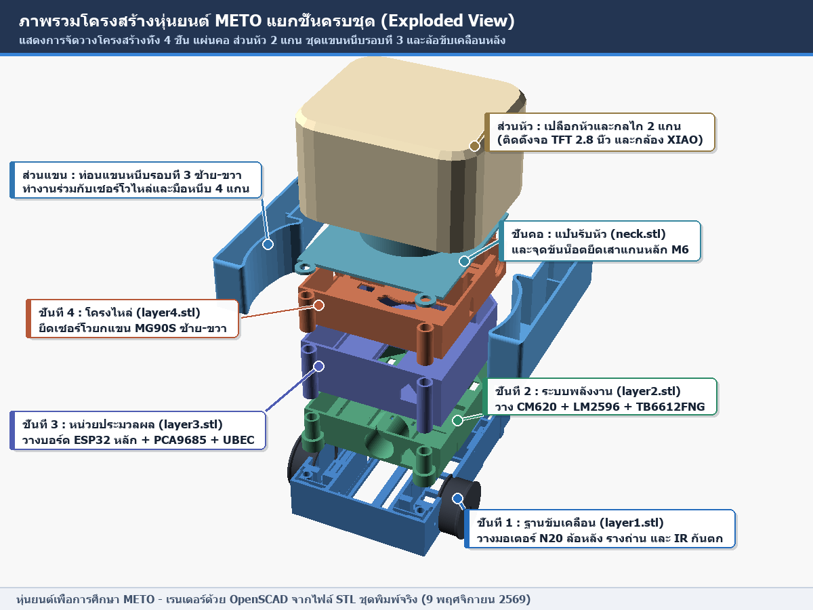
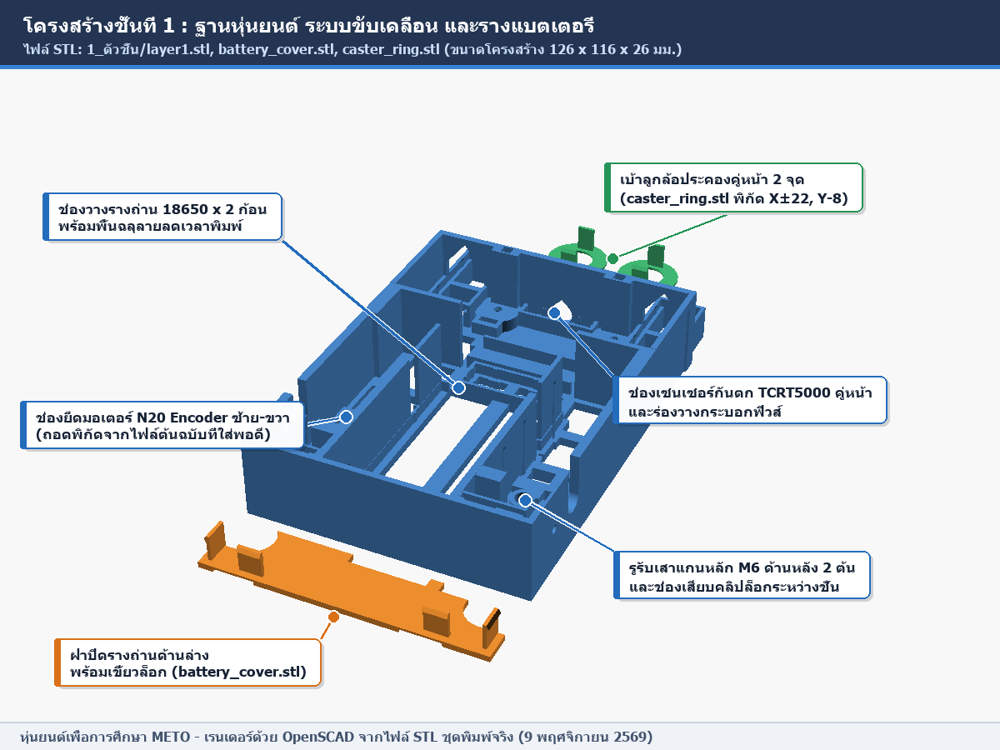
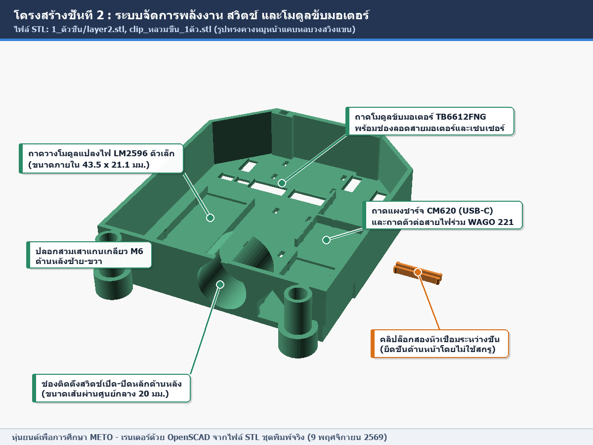
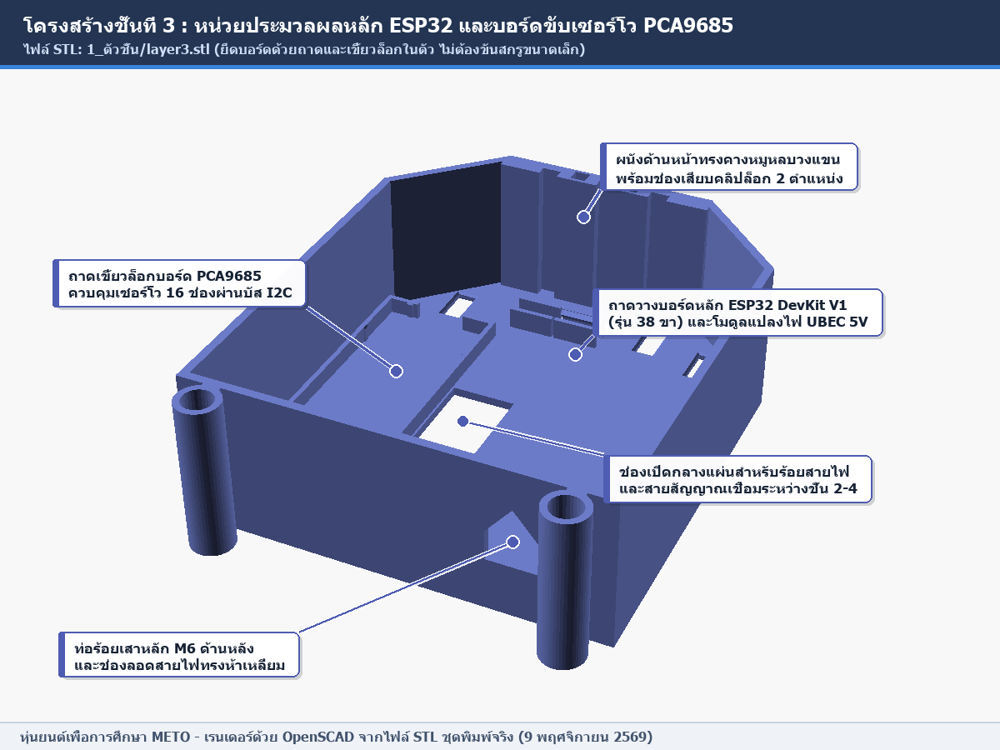
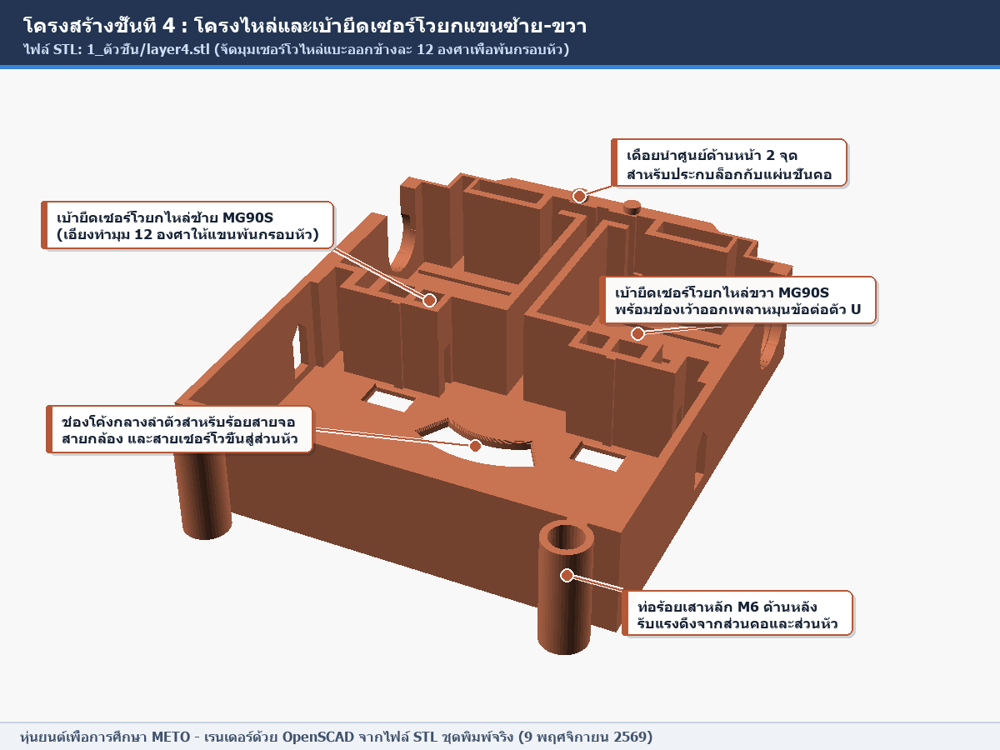
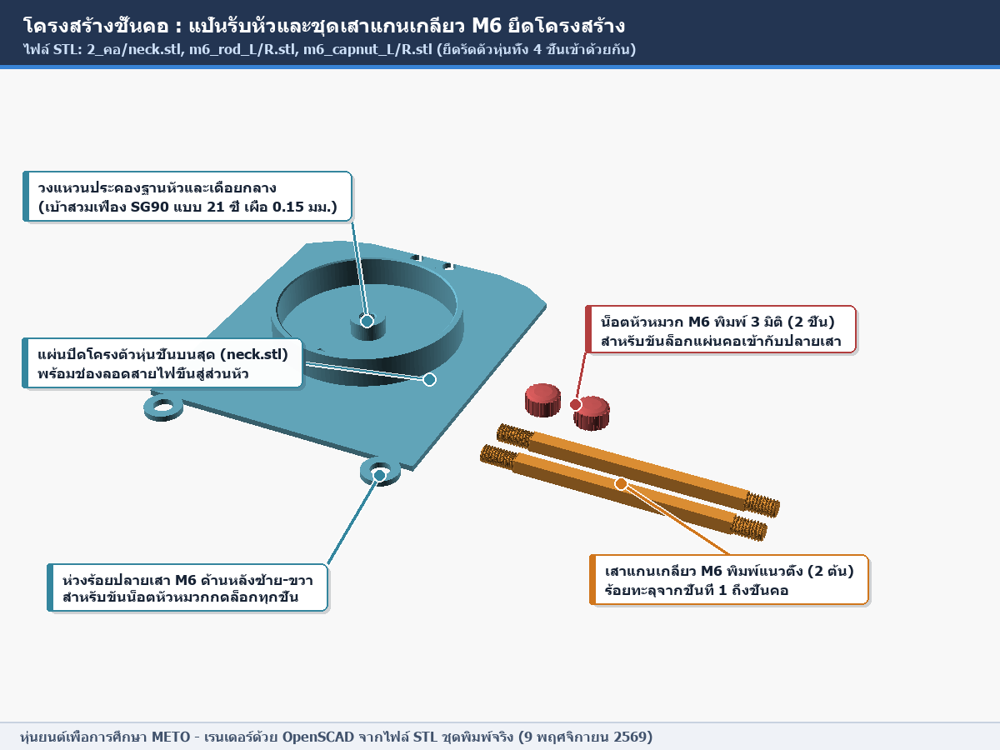
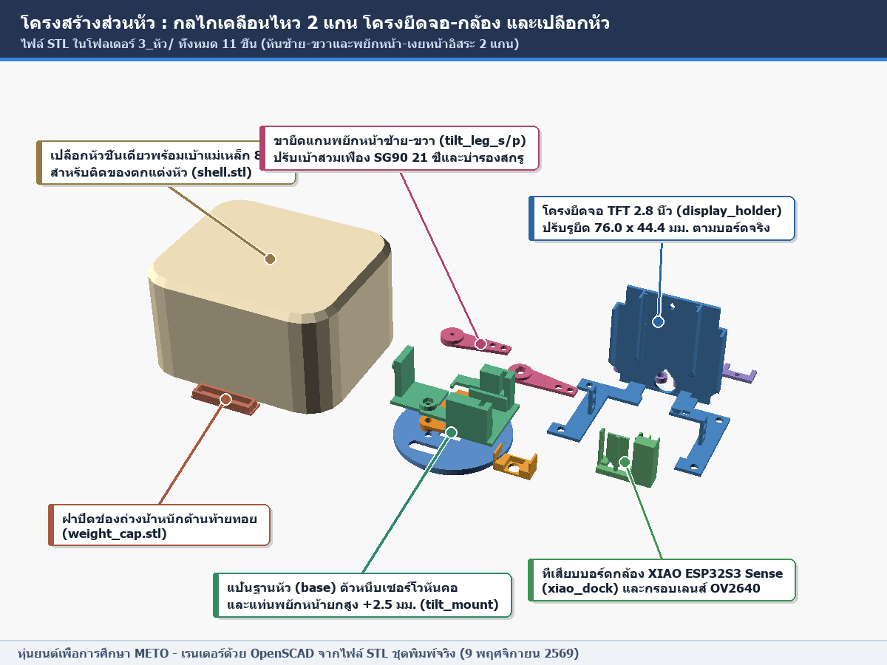
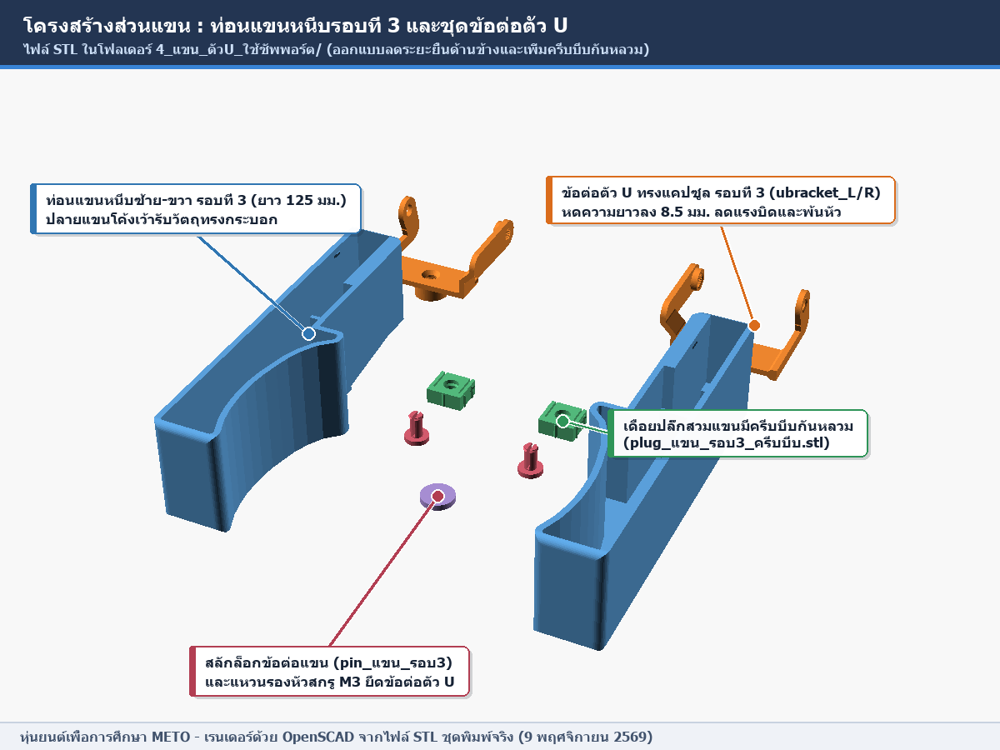

# สรุปอัปเดตความคืบหน้าโครงงานหุ่นยนต์เพื่อการศึกษา METO (ฉบับวันที่ 9 พฤศจิกายน 2569)

เอกสารฉบับนี้รวบรวมความคืบหน้าของโครงงานทั้งหมดตั้งแต่การปรับปรุงเล่มรายงานวิจัย การยื่นขอรับรองจริยธรรมการวิจัยในมนุษย์ (IRB) การส่งงานความก้าวหน้าในระบบ การพัฒนาเว็บแอปพลิเคชัน ไปจนถึงการสร้างหุ่นยนต์ต้นแบบตัวสำเร็จ (โครงสร้าง 3 มิติ เฟิร์มแวร์ ระบบกล้อง และผังการเดินสายไฟ) โดยจำแนกสถานะเป็น **[ทำแล้ว]** **[กำลังทำ]** และ **[ค้าง]** อย่างชัดเจน

---

## 1. การแก้ไขเล่มรายงานวิจัย (บทที่ 1 ถึง บทที่ 5)

การปรับปรุงเนื้อหาเล่มรายงานวิจัยดำเนินการเพื่อให้สอดคล้องกับแผนการทดลองจริงและสเปกฮาร์ดแวร์/ซอฟต์แวร์ของหุ่นยนต์ตัวสำเร็จ

### สถานะ **[ทำแล้ว]**
* **ปรับโครงสร้างการออกแบบการวิจัยในบทที่ 1-3 (ดีไซน์เปรียบเทียบ 8 ต่อ 8 คน)**
  * เปลี่ยนกลุ่มตัวอย่างเป็นนักศึกษาระดับปริญญาตรีชั้นปีที่ 1 มหาวิทยาลัยเทคโนโลยีพระจอมเกล้าธนบุรี (มจธ.) จำนวน 16 คน ที่ไม่มีพื้นฐานการเขียนโปรแกรม สุ่มเข้ากลุ่มทดลอง 8 คน (เรียนกับหุ่นยนต์ METO ที่เปิดการแสดงอารมณ์และท่าทางตอบสนอง) และกลุ่มควบคุม 8 คน (เรียนกับหุ่นยนต์ตัวเดียวกันที่ปิดระบบแสดงอารมณ์) พร้อมผู้เชี่ยวชาญ/อาจารย์ผู้สอนจำนวน 8 คนสำหรับประเมินความเหมาะสมของสื่อ
* **ตัดประเด็นการเคลมจุดขายด้านราคาถูกออกจากบทที่ 1-3**
  * ปรับแก้ข้อความที่ระบุว่าหุ่นยนต์มีต้นทุนต่ำและตัดข้อคำถามเรื่องความคุ้มค่าด้านราคาออกจากแบบสอบถามความพึงพอใจ เนื่องจากต้นทุนการพัฒนาหุ่นยนต์ต้นแบบจริงอยู่ที่ประมาณ 2,770-3,000 บาท โดยเปลี่ยนไปเน้นจุดเด่นด้านการตอบสนองทางอารมณ์ (Affective Computing) และการเรียนรู้แบบมีส่วนร่วมแทน
* **อัปเดตข้อมูลฮาร์ดแวร์และซอฟต์แวร์ในบทที่ 1-3 ให้ตรงกับของจริง**
  * แก้ไขชื่อบอร์ดประมวลผลเป็น ESP32 DevKit V1 (38 Pin) ทำงานร่วมกับบอร์ดขับเซอร์โว PCA9685 (I2C) และโมดูลขับมอเตอร์ TB6612FNG
  * แก้ไขส่วนแสดงผลและกล้องเป็นหน้าจอ TFT IPS ขนาด 2.8 นิ้ว (ST7789) และบอร์ดกล้อง Seeed Studio XIAO ESP32S3 Sense พร้อมโมดูลกล้อง OV2640
  * ปรับจำนวนอารมณ์ของหุ่นยนต์เป็น 9 อารมณ์ (เพิ่มอารมณ์เขินอาย Shy เป็นเอกลักษณ์หลัก) และหมวดหมู่บล็อกคำสั่ง 9 หมวดหมู่ รองรับการเชื่อมต่อผ่าน Wi-Fi โหมด Station (STA) และชื่อโดเมนท้องถิ่น `meto.local` (mDNS)
* **เพิ่มหัวข้อและแผนผังที่ขาดในบทที่ 1 และบทที่ 3**
  * เพิ่มหัวข้อ 1.5 นิยามศัพท์เฉพาะ และหัวข้อ 1.6 กรอบแนวคิดในการวิจัย (Conceptual Framework)
  * เพิ่มหัวข้อ 3.3.6 การออกแบบโครงสร้างทางกล และหัวข้อ 3.4-3.8 รายละเอียดเครื่องมือวิจัย (แบบทดสอบก่อน-หลังเรียน คะแนนเต็ม 25 คะแนน และแบบสอบถามมาตรประมาณค่า 5 ระดับ) รวมถึงสถิติที่ใช้ในการวิเคราะห์ข้อมูล (Wilcoxon Signed-Rank Test และ Mann-Whitney U Test)
* **จัดทำโครงร่างบทที่ 4 และบทที่ 5 พร้อมแทรกภาพโครงสร้างหุ่นรุ่นใหม่ในสำเนาเล่มรายงาน**
  * เตรียมไฟล์โครงร่างบทที่ 4-5 สำหรับการทดลองแบบ 8 ต่อ 8 คน เขียนบรรยายผลการพัฒนาฮาร์ดแวร์และซอฟต์แวร์ต้นแบบในหัวข้อ 4.2 และร่างข้อเสนอแนะเพื่อการพัฒนาต่อยอด (Future Work) ในบทที่ 5 เรื่องการประมวลผลภาพบนบอร์ดด้วย TinyML และการใช้โมเดลภาษาขนาดเล็กแบบติดตั้งเอง (Self-Hosted Local LLM)
  * สร้างสำเนาเล่มรายงานวิจัยฉบับล่าสุดพร้อมแทรกภาพเรนเดอร์โครงสร้างหุ่นยนต์ 3 มิติครบทุกชั้นและคำบรรยายประกอบในบทออกแบบหุ่นยนต์เรียบร้อยแล้ว (โดยไม่เขียนทับไฟล์ต้นฉบับ)

### สถานะ **[กำลังทำ]**
* **ปรับรายละเอียดตารางโครงสร้างทางกลในบทที่ 3 และเนื้อหาบทที่ 4 หัวข้อ 4.2**
  * ปรับปรุงตัวเลขขนาดและรายละเอียดการจัดวางอุปกรณ์ในตารางโครงสร้างทางกลให้ตรงกับหุ่นยนต์รุ่นตัวสำเร็จล่าสุด (โครงใน 4 ชั้น แผ่นคอ หัว 2 แกน แขนหนีบรอบที่ 3 และระบบลูกล้อคู่หน้า)

### สถานะ **[ค้าง]**
* **บันทึกผลการทดลองจริงลงในบทที่ 4 และสรุปผลในบทที่ 5**
  * รอนำผลคะแนนสอบวัดผลสัมฤทธิ์ก่อน-หลังเรียนและผลประเมินความพึงพอใจจากการเก็บข้อมูลจริง (กำหนดเก็บข้อมูลภายในวันที่ 20 พฤศจิกายน 2569) มาคำนวณค่าทางสถิติและเติมลงในหัวข้อ 4.3-4.10 เพื่อส่งเล่มรายงานครบ 5 บทภายในสิ้นเดือนพฤศจิกายน 2569 (กำหนดสอบโครงงานวันที่ 16-18 ธันวาคม 2569)

---

## 2. การยื่นขอรับรองจริยธรรมการวิจัยในมนุษย์ (IRB)

การเตรียมและส่งเอกสารขอรับรองจริยธรรมการวิจัยในมนุษย์ดำเนินการภายใต้ข้อกำหนดของคณะกรรมการจริยธรรมการวิจัยในมนุษย์ มจธ. (KMUTT-IRB)

### สถานะ **[ทำแล้ว]**
* **ปรับปรุงเอกสารชุด IRB ทั้งหมดให้สอดคล้องกับแผนการทดลองใหม่**
  * ปรับแก้เอกสารแบบฟอร์มการยื่นขอรับรอง (IRB02) โครงการวิจัยฉบับยื่นจริยธรรม (IRB03) เครื่องมือที่ใช้ในการวิจัยครบทั้ง 4 ชุด (IRB06 ชุด ก-ง) และเอกสารชี้แจงข้อมูลแก่ผู้เข้าร่วมวิจัยพร้อมหนังสือแสดงเจตนายินยอม (IRB07, IRB07.1, IRB07.2) ให้เป็นกลุ่มตัวอย่างนักศึกษาชั้นปีที่ 1 มจธ. จำนวน 16 คน และอาจารย์ผู้สอน 8 คน
* **จัดรูปแบบเอกสารและยื่นเข้าระบบพิจารณา**
  * ตรวจสอบความถูกต้องของเนื้อหา จัดหน้าเอกสารตามแบบฟอร์มมาตรฐาน และดำเนินการส่งเอกสารเข้าระบบขอรับรองจริยธรรมการวิจัยเรียบร้อยแล้วเมื่อวันที่ 5 พฤศจิกายน 2569

### สถานะ **[กำลังทำ]**
* **ติดตามสถานะการตรวจสอบเอกสารเบื้องต้น**
  * อยู่ระหว่างรอเจ้าหน้าที่และคณะกรรมการจริยธรรมตรวจสอบความครบถ้วนของเอกสารในระบบ

### สถานะ **[ค้าง]**
* **รอผลการอนุมัติและดำเนินการเก็บข้อมูลวิจัย**
  * รอรับใบรับรองหรือแก้ไขตามข้อเสนอแนะของคณะกรรมการ (ถ้ามี) และดำเนินการทดลองเก็บข้อมูลจริงกับกลุ่มตัวอย่างตามตารางเวลาที่วางไว้ภายในเดือนพฤศจิกายนถึงต้นเดือนธันวาคม 2569

---

## 3. การส่งงานความก้าวหน้าในระบบและการพบอาจารย์ที่ปรึกษา

การติดตามงานรายวิชาโครงงาน (MDT371 และ MDT470) และการรายงานความก้าวหน้าต่ออาจารย์ที่ปรึกษา (ผศ.ดร.เก็จแก้ว ธเนศวร)

### สถานะ **[ทำแล้ว]**
* **ส่งรายงานความก้าวหน้ารายวิชา MDT371 ครั้งที่ 5**
  * บันทึกและส่งรายงานความก้าวหน้าครั้งที่ 5 ในระบบติดตามโครงงานของรายวิชา MDT371 เรียบร้อยแล้ว
* **จัดทำเอกสารสรุปความคืบหน้าเพื่อเตรียมรายงานอาจารย์ที่ปรึกษา**
  * รวบรวมผลการพัฒนาเว็บแอปพลิเคชัน ระบบจำลองหุ่นยนต์ 3 มิติ และความคืบหน้าการประกอบหุ่นยนต์ตัวจริงสำหรับรายงานอาจารย์ที่ปรึกษาตามนัดหมายวันที่ 9 พฤศจิกายน 2569 เวลา 15:00 น.

### สถานะ **[กำลังทำ]**
* **นำเสนอความคืบหน้าต่ออาจารย์ที่ปรึกษา (9 พฤศจิกายน 2569)**
  * นำเสนอความก้าวหน้าของระบบเว็บบล็อกโค้ดดิ้ง แดชบอร์ดใหม่ หุ่นจำลอง 3 มิติ และชิ้นส่วนโครงสร้างหุ่นยนต์ที่พิมพ์และทดสอบวงจรแล้ว

### สถานะ **[ค้าง]**
* **ดำเนินการส่งงานความก้าวหน้ารายวิชา MDT470 และขอลายเซ็นรับรอง**
  * ขอลายเซ็นอาจารย์ที่ปรึกษาเพื่อรับรองใบรายงานความก้าวหน้ารายวิชา MDT470 ย้อนหลังจำนวน 3 ครั้ง (ครั้งที่ 1 กำหนด 25 กันยายน, ครั้งที่ 2 กำหนด 9 ตุลาคม, ครั้งที่ 3 กำหนด 30 ตุลาคม)
  * สร้างกลุ่มโครงงานในระบบและส่งรายงานความก้าวหน้าครั้งที่ 4 ของรายวิชา MDT470 ภายในกำหนดวันที่ 13 พฤศจิกายน 2569
* **เบิกจ่ายค่าวัสดุอุปกรณ์**
  * รวบรวมใบเสร็จค่าอุปกรณ์อิเล็กทรอนิกส์และเส้นพลาสติกพิมพ์ 3 มิติเพื่อทำเรื่องเบิกงบประมาณสนับสนุนโครงงานกับอาจารย์ที่ปรึกษา

---

## 4. การพัฒนาเว็บแอปพลิเคชัน (Block Coding, Digital Twin 3D และแดชบอร์ดใหม่รอบที่ 3)

ระบบซอฟต์แวร์เว็บแอปพลิเคชันได้รับการพัฒนาเพิ่มเติมทั้งในส่วนของบล็อกคำสั่ง ระบบจำลองหุ่นยนต์ 3 มิติบนเว็บ และหน้าแดชบอร์ดการจัดการเรียนรู้รูปแบบใหม่

### สถานะ **[ทำแล้ว]**
* **ขยายขีดความสามารถของระบบเขียนโค้ดแบบบล็อก (Block Coding)**
  * เพิ่มบล็อกคำสั่งใหม่รวมกว่า 20 บล็อก ครอบคลุมการเดินหน้า-ถอยหลังและเลี้ยวซ้าย-ขวาแบบกำหนดเวลาเป็นวินาที การสั่งยกแขน หันหัว และพยักหน้าแบบระบุองศา บล็อกมือหนีบอัจฉริยะ บล็อกกลับสู่ท่าเริ่มต้น (`home`) และบล็อกย้อนรอยเส้นทางกลับจุดเริ่มต้นอัตโนมัติ (`back` และ `failback`)
  * เชื่อมต่อบล็อกเซนเซอร์ (`มีวัตถุข้างหน้า?` และ `โดนลูบหัว?`) เข้ากับเอนจินรันโค้ด `MetoRunner` ให้ดึงค่าสถานะจริงจาก `/state` ของหุ่นยนต์มาประมวลผลในบล็อกเงื่อนไข `if` และลูป `while` ได้โดยตรง พร้อมปรับปรุงปุ่มหยุดฉุกเฉินให้สั่งหยุดมอเตอร์หุ่นยนต์ทันที
  * เพิ่มคำอธิบายวิธีใช้งานภาษาไทยครบทั้ง 77 บล็อก ปรับเวลาแสดงกล่องคำอธิบายให้ไวขึ้น (400 มิลลิวินาที) และแยกการแจ้งเตือนข้อผิดพลาดเป็น 2 ระดับ (ข้อผิดพลาดร้ายแรงแสดงกล่องเตือน / คำสั่งที่ไม่รู้จักให้หุ่นแสดงท่าทางสงสัยแล้วทำงานบรรทัดถัดไปต่อได้)
* **พัฒนาระบบหุ่นยนต์จำลอง 3 มิติบนเว็บ (Digital Twin 3D)**
  * สร้างหน้าจำลองหุ่นยนต์ 3 มิติ (`static/twin3d/`) จากไฟล์ชิ้นส่วน STL ของหุ่นจริงบนฉากหลังสีขาวสะอาดตา ขยับข้อต่อทั้ง 6 แกนตามคำสั่งบล็อกและใช้ตารางป้องกันแขนชนหัว (Interlock Table) ชุดเดียวกับเฟิร์มแวร์หุ่นจริง
  * จำลองหน้าจอแสดงดวงตาครบทั้ง 9 อารมณ์พร้อมการกะพริบตา ท่าทางประกอบอารมณ์ และท่าไอเดิลตรงตามหน้าจอ TFT ของจริง
  * เพิ่มระบบวางวัตถุจำลองบนพื้นสนาม (แก้วน้ำ ขวดน้ำ กระป๋อง) เพื่อทดสอบการเดินเข้าหาและหนีบยกวัตถุได้เสมือนจริง พร้อมรองรับทั้งโหมดบังคับด้วยแป้นพิมพ์และโหมดซิงก์การขยับตามหุ่นยนต์จริงแบบเรียลไทม์
* **ออกแบบและพัฒนาแดชบอร์ดใหม่รอบที่ 3 (Universal Web Dashboard)**
  * ปรับปรุงส่วนติดต่อผู้ใช้ (UI/UX) ใหม่ทั้งหมดโดยยกเลิกการใช้อีโมจิและเปลี่ยนเป็นไอคอน SVG ที่วาดขึ้นเอง ใช้ฟอนต์ Prompt เป็นมาตรฐานเดียวกันทั้งระบบ และใช้ถ้อยคำแบบสากลที่รองรับทั้งการเรียนด้วยตนเองและการเรียนในชั้นเรียน
  * เพิ่มหน้าต้อนรับ (`#/welcome`) ระบบภารกิจแรก 3 ขั้นตอนแทนทัวร์แนะนำแบบเดิม หน้าแผนที่ด่านการเรียนรู้แบบเส้นทางถนน SVG พร้อมกระดานโน้ตปักหมุด และระบบตรวจคำตอบโจทย์ท้าทายอัตโนมัติจากผลการทำงานของหุ่นจำลอง (`sim_ok`)
  * พัฒนาหน้าจัดการสำหรับผู้สอน ประกอบด้วย กล่องสรุปสิ่งที่ต้องตรวจ ตารางคะแนนรวม คอลัมน์แสดงสถานะปัจจุบันของผู้เรียนแต่ละคนแบบเรียลไทม์ หน้าฉายรหัสห้องเรียนพร้อมคิวอาร์โค้ด (`segno`) สำหรับขึ้นจอโปรเจกเตอร์ และระบบส่งออกรายงานผลเป็นไฟล์ Excel (`.xlsx` จำนวน 5 แผ่นงานภาษาไทยด้วยไลบรารี `openpyxl`) โดยผ่านการจำลองทดสอบการใช้งานครบทุกบทบาทแล้ว

### สถานะ **[กำลังทำ]**
* **เพิ่มตัวเลือกสวมของตกแต่งหัวในหน้า Digital Twin 3D**
  * เชื่อมต่อโมเดลของสวมหัว (หนวดมด หูแมว หูหมี หมวกฟาง) เข้ากับหน้าจำลองหุ่น 3 มิติให้ผู้ใช้เลือกสลับแสดงผลได้บนหน้าเว็บ
* **เตรียมโครงสร้าง Git Repository สำหรับอัปเดตเซิร์ฟเวอร์ออนไลน์**
  * ตั้งค่าไฟล์ `.gitignore` เพื่อป้องกันไม่ให้ไฟล์รหัสผ่านและเอกสารภายในถูกอัปโหลดขึ้นคลังโค้ดสาธารณะ

### สถานะ **[ค้าง]**
* **อัปเดตโค้ดขึ้นระบบคลาวด์ Render และทดสอบร่วมกับหุ่นตัวสำเร็จ**
  * รอคำสั่งอนุมัติจากเจ้าของโครงงานเพื่อส่งโค้ดขึ้น GitHub/Render และทำการทดสอบสั่งงานจากเว็บบล็อกผ่าน Wi-Fi ไปยังหุ่นยนต์ตัวสำเร็จที่ประกอบสมบูรณ์

---

## 5. การพัฒนาหุ่นยนต์ METO ตัวสำเร็จ (โครงสร้าง 3 มิติ / เฟิร์มแวร์ / กล้อง / ผังสายไฟ)

การสร้างหุ่นยนต์ต้นแบบตัวสำเร็จแบ่งออกเป็น 4 ส่วนย่อย ได้แก่ โครงสร้างทางกล 3 มิติ เฟิร์มแวร์ควบคุมหุ่นยนต์ ระบบกล้องและปัญญาประดิษฐ์มองเห็นภาพ และระบบไฟฟ้าพร้อมผังการเดินสายไฟ

### 5.1 โครงสร้าง 3 มิติและการพิมพ์ชิ้นส่วน (3D Structure & Printing)

#### สถานะ **[ทำแล้ว]**
* **ออกแบบโครงสร้างภายใน 4 ชั้น แผ่นคอ หัว 2 แกน และชุดแขนหนีบรอบที่ 3 ด้วย OpenSCAD**
  * ออกแบบแผ่นโครงสร้างตัวหุ่น 4 ชั้น (`layer1` ถึง `layer4`) รูปทรงคางหมูหน้าแคบเพื่อหลบวงสวิงแขน ยึดระหว่างชั้นด้านหน้าด้วยคลิปล็อกสองหัวแบบหัวเข็มขัดกระเป๋าและยึดด้านหลังด้วยเสาแกนเกลียว M6 จำนวน 2 ต้น โดยใช้ถาดและเขี้ยวล็อกบอร์ดอิเล็กทรอนิกส์แทนการใช้สกรูขนาดเล็กทั้งหมด
  * ปรับปรุงแผ่นชั้นที่ 1 (`layer1.stl`) รอบล่าสุด (9 พฤศจิกายน) โดยถอดพิกัดโซนยึดมอเตอร์และรูเพลาจากไฟล์ต้นฉบับที่ใส่พอดีแล้วมาผสานเข้ากับพื้นฉลุลายเพื่อลดเวลาพิมพ์ พร้อมย้ายเบ้าลูกล้อประคองคู่หน้า (`caster_ring.stl`) มาที่พิกัด X±22, Y-8 ด้านหลังช่องเซนเซอร์กันตก และเพิ่มร่องวางกระบอกฟิวส์พร้อมฝาปิดรางถ่าน (`battery_cover.stl`)
  * ปรับปรุงแผ่นชั้นที่ 2 (`layer2.stl`) ให้พอดีกับขนาดจริงของแผงชาร์จ CM620 (36.6x17.8 มม.) โมดูลแปลงไฟ LM2596 รุ่นตัวเล็ก (43.5x21.1 มม.) โมดูลขับมอเตอร์ TB6612FNG และเปิดขอบถาดตัวต่อสายไฟ WAGO 221 ให้สอดสายได้สะดวก
  * ออกแบบแผ่นชั้นที่ 3 (`layer3.stl`) สำหรับวางบอร์ด ESP32 DevKit V1 (38 ขา) บอร์ด PCA9685 และโมดูลแปลงไฟ UBEC 5V/5A และแผ่นชั้นที่ 4 (`layer4.stl`) สำหรับยึดเซอร์โวยกไหล่ MG90S ซ้าย-ขวาทำมุมแบะออกข้างละ 12 องศาเพื่อพ้นกรอบหัว
  * ออกแบบแผ่นคอ (`neck.stl`) พร้อมเบ้าสวมเฟืองเซอร์โว SG90 แบบ 21 ซี่ (เผื่อระยะ 0.15 มม. และมีบ่ารองหัวสกรู) เสาแกนเกลียว M6 พิมพ์แนวตั้ง (`m6_rod_L/R.stl`) และน็อตหัวหมวก (`m6_capnut_L/R.stl`)
  * ออกแบบชุดโครงสร้างส่วนหัว 2 แกน ประกอบด้วย แป้นฐานหัว (`base.stl`) ตัวหนีบเซอร์โวหันคอ (`sg_clamp.stl`) แท่นรับเซอร์โวพยักหน้ายกสูงขึ้น 2.5 มม. (`tilt_mount.stl`) ขายึดแกนพยักหน้าซ้าย-ขวา (`tilt_leg_s.stl`, `tilt_leg_p.stl`) โครงยึดจอ TFT ขนาด 2.8 นิ้วที่สลับช่องหลบขาพินและปรับระยะรูยึดเป็น 76.0x44.4 มม. ตามบอร์ดจริง (`display_holder.stl`) ที่เสียบบอร์ดกล้องพร้อมลิ้นล็อกและครีบบีบ (`xiao_dock.stl`) กรอบประคองเลนส์กล้องแยกชิ้น (`cam_frame.stl`) และเปลือกหัวชิ้นเดียวพร้อมเบ้าแม่เหล็ก 8 จุด (`shell.stl`, `weight_cap.stl`)
  * ออกแบบชุดแขนหนีบรอบที่ 3 (`ท่อนแขน_L/R_รอบ3.stl` ความยาว 125 มม.) ข้อต่อตัว U ทรงแคปซูล (`ubracket_L/R_รอบ3.stl`) เดือยปลั๊กมีครีบบีบกันหลวม (`plug_แขน_รอบ3_ครีบบีบ.stl`) สลักล็อก (`pin_แขน_รอบ3.stl`) และแหวนรองหัวสกรู M3 (`แหวนรองหัวสกรูM3_ตัวU.stl`) รวมถึงล้อขับเคลื่อนหลังขนาดเส้นผ่านศูนย์กลาง 41 มม. (`wheel_พิมพ์2ชิ้น.stl`) กระเป๋าหลังเปิดได้ 2 บาน (`door_L/R.stl`) และของตกแต่งสวมหัวติดแม่เหล็ก (`หนวดมด_ติดแม่เหล็ก_คู่.stl`)
  * ตั้งค่าโปรไฟล์การพิมพ์ความเร็วสูงในโปรแกรม Creality Print (`0.24mm Fast` และ `0.32mm Rush`) เพื่อลดระยะเวลาการพิมพ์ชิ้นส่วนโครงสร้าง

#### สถานะ **[กำลังทำ]**
* **พิมพ์ชิ้นส่วนชุดแก้ไขล่าสุดประจำวันที่ 9 พฤศจิกายน**
  * ดำเนินการพิมพ์แผ่นรวมชิ้นส่วนชั้นที่ 1 ชุดแก้ไขโซนมอเตอร์ ตัวจับจอและกรอบกล้อง ชุดคอและขาพยักหน้ารุ่นเบ้าเฟือง 21 ซี่ แกนเสา M6 และชุดล้อขับเคลื่อน

#### สถานะ **[ค้าง]**
* **ตรวจอนุมัติเปลือกนอกตัวหุ่นสองสีและประกอบร่างหุ่นยนต์ตัวสำเร็จ**
  * รอเจ้าของโครงงานตรวจสอบแบบเปลือกนอกตัวหุ่นรุ่นแยกสองสี (ผ่าแนวแกนแขนและช่องสายไฟ) พร้อมของสวมหัวเพิ่มเติม (หูแมว หูหมี หมวกฟาง) และดำเนินการประกอบโครงสร้างทั้งหมดตั้งแต่ชั้นที่ 1 ถึงส่วนหัวเข้าด้วยกัน

---

### 5.2 เฟิร์มแวร์และระบบควบคุมหุ่นยนต์ (`RoboPCA9685.ino` และ `meto_emotes.h`)

#### สถานะ **[ทำแล้ว]**
* **พัฒนาเฟิร์มแวร์หลักรวมระบบขับเคลื่อนล้อและเซอร์โว 6 แกน**
  * ผสานโค้ดควบคุมมอเตอร์ล้อพร้อมตัวอ่านค่า Encoder เข้ากับระบบขับเซอร์โว 6 ช่องผ่านบอร์ด PCA9685 แบบเคลื่อนที่นุ่มนวล (Smooth Interpolation) และฝังตารางป้องกันแขนชนหัว (`meto_interlock_table.h`) ที่คำนวณจากการจำลองการชนกว่า 1.41 ล้านท่า
* **สร้างชุดท่าทางและอารมณ์ 51 ท่า (คาแรกเตอร์ขี้อาย)**
  * ออกแบบการเคลื่อนไหวประกอบดวงตาบนจอ TFT รวม 51 ท่า ประกอบด้วย 9 อารมณ์หลัก (อารมณ์ละ 3 รูปแบบสุ่ม พร้อมการกะพริบตา) ท่าตอบสนองเมื่อถูกลูบหัว 5 ท่า ท่าไอเดิลขณะรอคำสั่ง 15 ท่า (จบด้วยการวางแขนพักลงที่มุม -30 องศาเสมอ และระงับการใช้แขนหลังรันโค้ดจบหรือเมื่อมีวัตถุอยู่ใกล้หน้าหุ่น) และท่าแสดงผลตามเหตุการณ์ (หนีบของสำเร็จ เจอขอบโต๊ะ รันโค้ดจบ โค้ดมีบั๊ก ไม่พบวัตถุ)
* **พัฒนาระบบป้องกันตกโต๊ะอัตโนมัติและทดสอบฮาร์ดแวร์เซอร์โวครบทุกตัว**
  * ตั้งค่าอินเทอร์รัปต์ (ISR) จากเซนเซอร์อินฟราเรด TCRT5000 ซ้าย-ขวา ให้สั่งเบรกมอเตอร์ทันทีในทุกโหมดการเดิน ตามด้วยการเบรกนุ่มและถอยหลังกลับอัตโนมัติ
  * ทดสอบการหมุนและตั้งศูนย์เซอร์โวของจริงทุกตัวด้วยโปรแกรม `ServoCenter` พบว่าเซอร์โว MG90S มือหนีบขวาตัวเดิมเสียและช่องสัญญาณ CH3 บนบอร์ด PCA9685 มีปัญหา จึงเปลี่ยนตัวเซอร์โวใหม่และย้ายช่องสัญญาณมือหนีบขวาในเฟิร์มแวร์จาก CH3 ไปใช้ช่อง **CH6** แทนจนทำงานได้ครบทั้ง 6 แกน

#### สถานะ **[กำลังทำ]**
* **เพิ่มคำสั่งเปิด-ปิดโหมดไอเดิลผ่านเว็บและตรวจสอบโค้ดก่อนแฟลชจริง**
  * เพิ่มการรองรับคำสั่ง `!idle 0/1` สำหรับล็อกหุ่นให้นิ่งสนิทระหว่างการจัดท่าประกอบหรือการทดลองกลุ่มควบคุม

#### สถานะ **[ค้าง]**
* **แฟลชเฟิร์มแวร์หลักฉบับเปิดหน้าจอ TFT และสอบเทียบมุมหนีบจริง**
  * รอคำสั่งอนุมัติเพื่อแฟลชเฟิร์มแวร์หลัก (`RoboPCA9685.ino` ที่เปิด `USE_TFT 1`) ลงบอร์ด ESP32 หลัก และปรับเทียบค่ามุมปิดสุดของมือหนีบซ้าย-ขวาหลังประกอบแขนเข้ากับตัวหุ่นเสร็จสิ้น

---

### 5.3 ระบบกล้องและปัญญาประดิษฐ์มองเห็นภาพ (`FullCam` v10 และ `tools/meto_vision/`)

#### สถานะ **[ทำแล้ว]**
* **พัฒนาและแฟลชเฟิร์มแวร์กล้อง `FullCam` v10 ลงบอร์ด XIAO ESP32S3 Sense สำเร็จ**
  * พัฒนาเฟิร์มแวร์สำหรับบอร์ดกล้องทำหน้าที่ตรวจจับใบหน้า (ส่งพิกัด `F<x>,<y>,<w>` ให้บอร์ดหลักสั่งหันหัวมองตามและแสดงอารมณ์เขินเมื่อสบตา) ตรวจจับการโบกมือใกล้ด้านบนหน้ากล้องเพื่อใช้แทนการลูบหัวชั่วคราว (`P`) และตรวจจับวัตถุตรงหน้าขณะก้มหัวมองเพื่อยืนยันการหนีบยกวัตถุ (`O`) แทนเซนเซอร์วัดระยะ VL53L0X ที่ยังขาด
  * แฟลชเฟิร์มแวร์ลงบอร์ดกล้องจริงผ่านพอร์ต COM4 สำเร็จ บูตระบบกล้อง OV2640 ทำงานได้ที่ความเร็ว 24 FPS เชื่อมต่อ Wi-Fi ฮอตสปอต (`192.168.43.155`) และเปิดหน้าเว็บสตรีมภาพสด (`:81/stream` และ `/capture`) ได้จริง
* **พัฒนาระบบประมวลผลภาพเสริมบนคอมพิวเตอร์ (`tools/meto_vision/`)**
  * สร้างสคริปต์ Python ดึงภาพจากบอร์ดกล้องมาวิเคราะห์ด้วยโมเดล YOLOv8n (จำแนกบุคคล ขวดน้ำ แก้วน้ำ) และโมเดล YuNet/SFace (จดจำใบหน้าเจ้าของ) เพื่อส่งคำสั่งตอบสนองกลับไปยังหุ่นยนต์

#### สถานะ **[กำลังทำ]**
* **ปรับสภาพแสงและจัดการการระบายความร้อนของบอร์ดกล้อง**
  * ปรับความสว่างในสภาพแวดล้อมขณะทดสอบเพื่อให้โมเดลตรวจจับใบหน้าทำงานได้แม่นยำขึ้น และตรวจสอบการระบายความร้อนเมื่อสตรีมภาพต่อเนื่อง

#### สถานะ **[ค้าง]**
* **ทดสอบการหันหัวตามใบหน้าและการตรวจจับวัตถุร่วมกับหุ่นจริง**
  * รอประกอบชุดหัวเข้ากับลำตัวหุ่นเพื่อทดสอบการทำงานร่วมกันระหว่างบอร์ดกล้อง (ผ่านสาย UART ขา D6 ไปยัง GPIO13 ของบอร์ดหลัก) กับการขยับเซอร์โวคอและแขนจริง

---

### 5.4 ระบบไฟฟ้าและผังการต่อสายไฟแยกตามชั้น (`stl redesigned/ผังต่อสายแยกชั้น_9พย/`)

#### สถานะ **[ทำแล้ว]**
* **จัดทำตารางตัดสายไฟและภาพผังการต่อสายไฟแยกตามชั้นครบทุกส่วน**
  * สรุปรายการสายไฟทั้งหมด 36 เส้นพร้อมระบุสีและความยาวในไฟล์ `สายไฟ.md` และสร้างภาพแผนผังการเดินสายไฟแยกตามชั้น (`ชั้น1.png`, `ชั้น2.png`, `ชั้น3.png`, `ชั้น4.png`, `คอ_หัว.png`, `แขน.png`) เพื่อใช้เป็นคู่มือประกอบจริง
* **ไล่วงจรและแก้ไขปัญหาการจ่ายไฟเลี้ยงบนฮาร์ดแวร์จริงสำเร็จ**
  * ตรวจสอบแรงดันแบตเตอรี่ลิเธียมไอออน 18650 จำนวน 2 ก้อนต่ออนุกรมได้ประมาณ 7.0V ปรับตั้งแรงดันขาออกของโมดูล LM2596 ตัวเล็กสำหรับเลี้ยงบอร์ดลอจิกไว้ที่ประมาณ 4.86-5.0V
  * แก้ปัญหาไฟเลี้ยงรางเซอร์โวบนบอร์ด PCA9685 ที่ไม่ผ่านขั้วสกรูสีเขียว โดยเปลี่ยนไปจ่ายไฟ 5V จากโมดูล UBEC 5A เข้าทางขา V+ ของช่อง CH15 โดยตรง และย้ายสายสัญญาณมือหนีบขวาไปที่ช่อง CH6 ทำให้เซอร์โวทุกตัวได้รับไฟเลี้ยงและทำงานได้สมบูรณ์

#### สถานะ **[กำลังทำ]**
* **จัดระเบียบสายไฟเข้าตามรางและช่องลอดสายระหว่างชั้น**
  * เดินสายไฟจริงตามความยาวที่กำหนดและร้อยผ่านช่องลอดสายของแผ่นโครงสร้างแต่ละชั้นไม่ให้กีดขวางการหมุนของเซอร์โว

#### สถานะ **[ค้าง]**
* **ทดสอบระยะเวลาการใช้งานแบตเตอรี่ต่อเนื่องและการชาร์จไฟ**
  * ทดสอบเปิดเครื่องทำงานพร้อมกันทั้งมอเตอร์ เซอร์โว จอ TFT และกล้อง เพื่อวัดระยะเวลาใช้งานจริงต่อการชาร์จหนึ่งครั้ง และทดสอบการชาร์จไฟผ่านพอร์ต USB-C ของแผงวงจร CM620 หลังประกอบตัวหุ่นเสร็จสมบูรณ์
